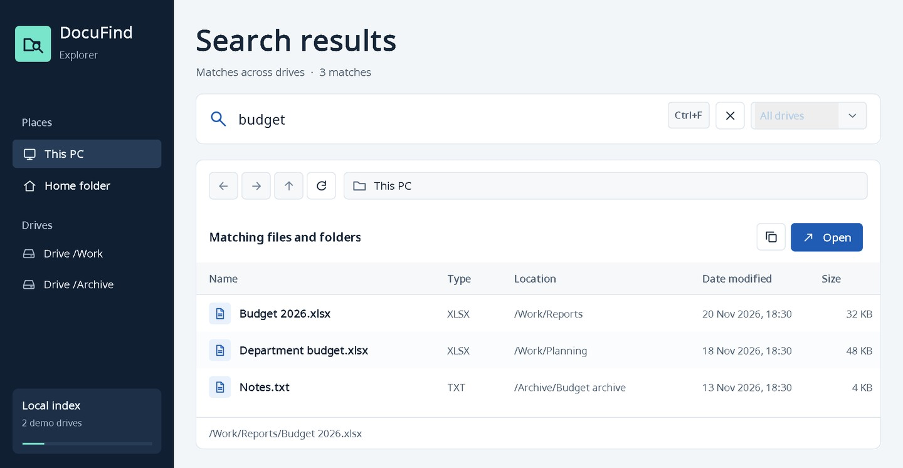

<div align="center">
  
  <h1>DocuFind Explorer</h1>
  <p><strong>Find the file you remember.</strong></p>
  <p>A Windows file explorer that searches across your drives and opens files right where you saved them.</p>
  <p>
    <a href="#get-docufind">Get DocuFind</a> ·
    <a href="#your-first-search">Try a search</a> ·
    <a href="#how-it-works">How it works</a> ·
    <a href="#build-from-source">Build from source</a>
  </p>
</div>

---

You remember the word **budget**, but the workbook could be in Documents, on your work drive, or in an archive. Open DocuFind and type **budget**. The results show the file name and its location, so you can pick the workbook and open it from the same window.

<div align="center">
  
  <br>
  <sub>DocuFind search results with sample files and drive paths.</sub>
</div>

## Get DocuFind

**Windows x64** · **Works offline** · **Java included in the Windows packages**

- **Standalone EXE:** Open the standalone `DocuFind-2.2.0.exe` from the Windows release package. It includes the app and its Java runtime. The first launch unpacks the files it needs into your local app data folder.
- **GitHub Actions installer:** In your repository, open **Actions → Build DocuFind for Windows → Run workflow**. After a successful run, download and extract the **DocuFind-Windows-Installer** artifact. Run the installer inside, then open **DocuFind** from the Start menu.

> **Using an app image?** Keep its launcher, `app` folder and `runtime` folder together. The launcher loads its configuration from that directory.

## Your first search

1. **Open DocuFind.** The sidebar shows **This PC**, **Home folder**, and drives the app can access. You can browse while it builds the search catalog.
2. **Type a clue.** Try `budget`, a filename such as `Budget 2026.xlsx`, or part of a folder path. Use **All drives** to search across drives, or open a folder and select **Current folder** to search inside it and its subfolders.
3. **Open the original.** Check the **Location** and **Date modified** columns, then press **Enter** or double-click a result. Right-click to open its containing folder or copy its full path.

| Shortcut | What it does |
| :--- | :--- |
| `Ctrl+F` | Focus the search box |
| `Alt+D` | Focus the address bar |
| `Alt+Left` / `Alt+Right` / `Alt+Up` | Go back, forward, or to the parent folder |
| `Esc` | Clear the search |
| `F5` | Refresh the current view |
| `Ctrl+Shift+C` | Copy the selected path |

## How it works

**Your drives are the starting point.** DocuFind discovers accessible drives automatically. It reads folders in the background and saves file details in batches. A file becomes searchable after its entry is saved, even if other folders are still being scanned.

**Search reads a local catalog.** A SQLite database stores names, paths, sizes and modification dates. DocuFind searches those saved details and opens the original file from its existing location. On Windows, the catalog usually lives at `%LOCALAPPDATA%\DocuFindData\explorer.db`.

**The catalog follows changes.** While DocuFind runs, it watches for file changes and periodically checks drives again to catch missed updates. A new or renamed file can take a moment to appear. Access permissions can limit which folders are covered.

> **Search tip:** One or two characters match the beginning of a filename. With three or more, DocuFind also looks inside filenames and paths. If you see **First 250 matches**, add a more specific clue or choose a narrower scope.

## Build from source

### Run the app and its tests

From the repository root, with **JDK 17 or later**, **Maven 3.9 or later**, and a graphical desktop:

```bash
cd docufind
mvn -B clean verify
java -jar target/docufind.jar
```

The Maven build runs the JUnit tests and creates the runnable JAR. The app uses Java Swing for the desktop window, Java NIO for filesystem access, and SQLite with FTS5 for filename and path search.

### Build the Windows installer

With **Windows x64**, **JDK 21**, **Maven 3.9 or later**, and **WiX Toolset 3.14** on your PATH, run this from the repository root in Command Prompt:

```bat
docufind\build-windows.cmd
```

The script runs the tests and puts the installer under `docufind\target\windows\installer\`. The [Windows workflow](.github/workflows/build-windows.yml) runs the same script. To package a standalone executable from a prepared Windows app image, see the [native launcher guide](native-launcher/README.md).

| Project area | What you'll find |
| :--- | :--- |
| [Application](docufind/src/main/java/io/docufind/) | Explorer window, file table, drive scanner and search catalog |
| [Tests](docufind/src/test/java/io/docufind/) | Checks for search, browsing, filesystem updates and table behavior |
| [Native launcher](native-launcher/) | Packaging tools for the standalone Windows EXE |

<details>
<summary>Launching the standalone EXE with Wine</summary>

Run this in the folder containing the standalone EXE. Set `WINEPREFIX` to your own prefix path.

```bash
WINEPREFIX="$HOME/windows-system/Windows-testing/wine-env" wine ./DocuFind-2.2.0.exe
```

DocuFind skips Wine's host-wide `Z:\` mapping when `WINEPREFIX` is set. For a specific host folder, map it to a dedicated drive letter in Wine. A full graphical Wine launch of this package has yet to be verified.

</details>
